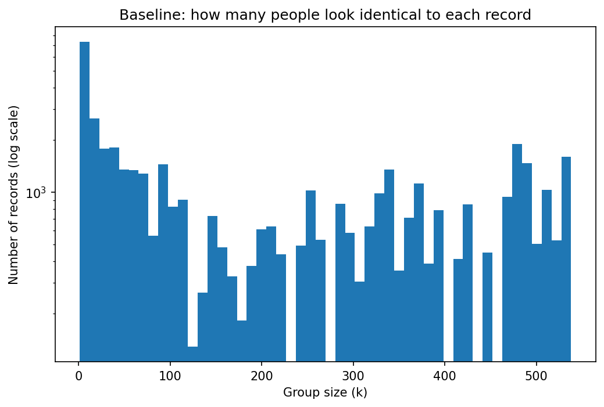
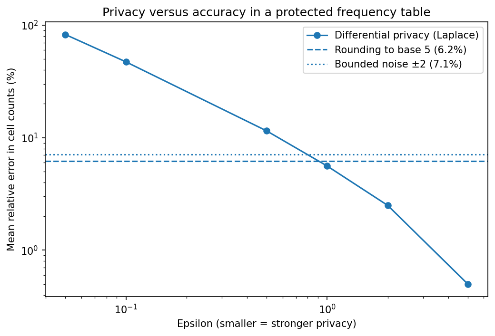

# Privacy versus utility: protecting sensitive data without destroying it

How much can you blur a dataset to protect people before the data stops being useful? This project measures that trade-off on the public UCI Adult census dataset, from individual records through to published statistical tables.

**Note:** the data is a standard public benchmark, not real sensitive data. The aim is to demonstrate the methods and the reasoning.

## Question

1. How easily can people be re-identified in a "de-identified" dataset?
2. What does it cost in accuracy to protect them?
3. How do simple table-protection methods compare with differential privacy?

## Data and threat model

- Source: UCI Adult dataset (48,842 rows), 45,222 after removing rows with missing values.
- Quasi-identifiers: age, sex, race, marital status, native country.
- Sensitive attribute: income class (above or below $50K).
- Threat: someone who knows a person's five quasi-identifier values tries to find their row and learn their income.

## Results

### 1. Baseline risk

| | Unique records (k=1) | Records with k<5 |
|---|---|---|
| Original data | 2,539 (5.6%) | 5,043 (11.2%) |

Removing one detailed column (native country, 41 values) cut unique records to 555 (1.2%), which shows that detailed attributes with many rare values drive re-identification risk.

### 2. k-anonymity (generalisation and suppression)

Age was grouped into 6 bands, marital status into 3 groups and country into 2 groups. Records still in groups smaller than 5 were suppressed.

| | Unique records | Records with k<5 | Records |
|---|---|---|---|
| Original | 2,539 (5.6%) | 5,043 (11.2%) | 45,222 |
| After generalisation | 37 (0.1%) | 176 (0.4%) | 45,222 |
| After suppression (k=5) | 0 | 0 | 45,046 |

### 3. Cost in utility

A Random Forest predicting income class, mean and standard deviation over 3 random splits, on the same 45,046 people.

| Model | Original | Protected |
|---|---|---|
| All features, accuracy | 0.840 ± 0.005 | 0.847 ± 0.004 |
| All features, F1 | 0.655 ± 0.013 | 0.663 ± 0.013 |
| Quasi-identifiers only, accuracy | 0.769 ± 0.004 | 0.769 ± 0.005 |
| Quasi-identifiers only, F1 | 0.541 ± 0.006 | 0.524 ± 0.007 |

With all features there was no meaningful difference. Using only the blurred columns, F1 fell by about 0.017. Accuracy hides this because 75.2% of people earn under $50K, so always guessing "low income" already scores 0.752.

### 4. What k-anonymity does not protect

47 of 211 groups (643 people, 1.4%) contain only one income class, so finding the group reveals the person's income without singling them out. k-anonymity prevents being found, not being learned about.

### 5. Protecting a frequency table

On the five-column table (211 non-empty cells out of 360 possible):

| Method | Result |
|---|---|
| Suppress cells below 10 | 48 cells hidden (22.7% of cells) but only 332 people (0.7%) |
| Round to base 5 | mean relative error 6.2% |
| Bounded random noise (±2) | mean relative error 7.1% |

### 6. Differential privacy (Laplace mechanism)

Noise scaled to 1/ε was added to every possible cell, including empty ones, averaged over 50 runs.

| ε | Mean error (people) | Mean relative error |
|---|---|---|
| 0.05 | 16.97 | 82.6% |
| 0.1 | 9.09 | 47.2% |
| 0.5 | 1.98 | 11.5% |
| 1 | 0.96 | 5.6% |
| 2 | 0.42 | 2.5% |
| 5 | 0.08 | 0.5% |

At ε = 1, accuracy is comparable to rounding and bounded noise, but with a formal privacy guarantee.

## Limitations

- One dataset, one table, three random splits and 50 noise repeats. The comparisons are indicative, not definitive.
- The ε values apply to a single release. Publishing several tables from the same data uses up the privacy budget.
- Setting negative noisy counts to zero adds a small upward bias.
- Rounding and bounded noise carry no formal guarantee. Repeated releases with fresh noise could be averaged to recover true counts.
- Publishing totals alongside a protected table can allow hidden cells to be recovered by subtraction.
- Only counts were protected. Magnitude data, such as total income in a cell, is harder because one person can change a cell by a large amount.
- The data has one row per person, so protecting one row protects one person. This isn't true of all datasets.
- Possible next step: l-diversity, to remove groups where everyone shares the same sensitive value.

## How to run

Open `privacy_utility_tradeoff.ipynb` in Google Colab and choose **Runtime → Run all**. The notebook downloads the dataset itself. Libraries used: pandas, NumPy, scikit-learn, matplotlib.
